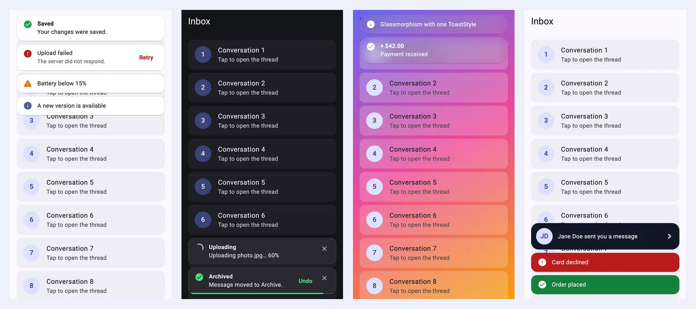
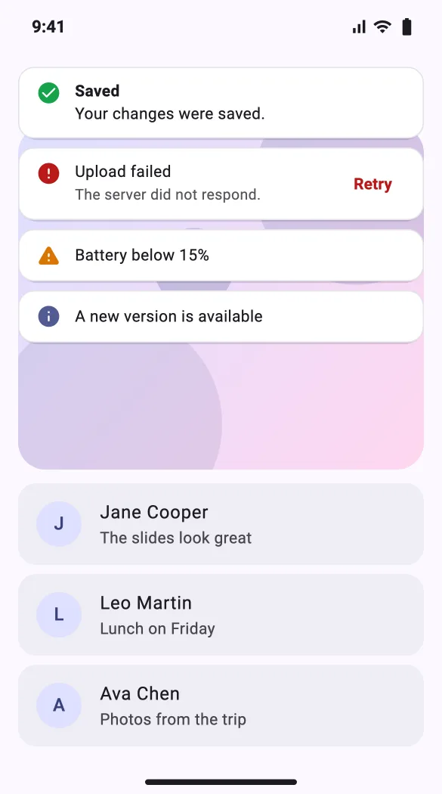
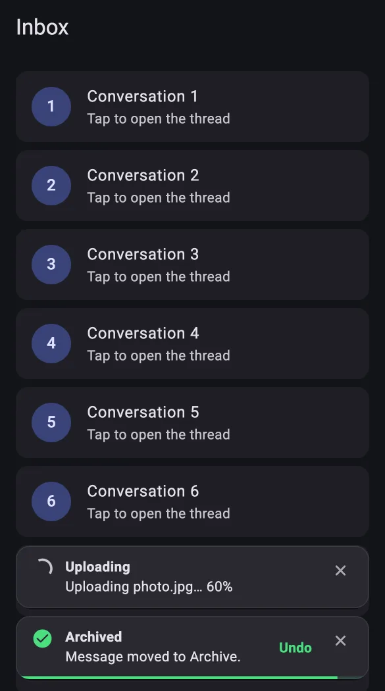
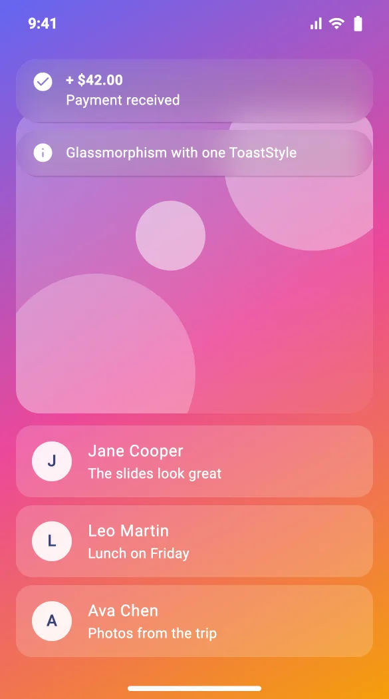
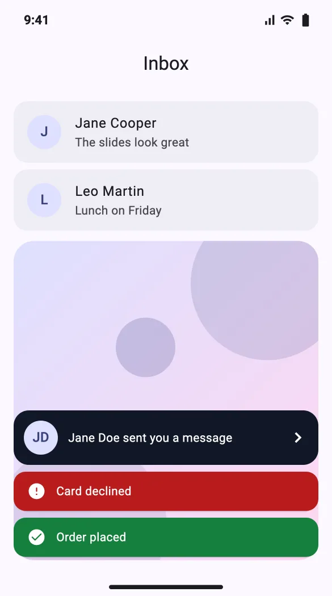

# better_toast: customizable Flutter toast notifications, no context needed

[](https://pub.dev/packages/better_toast)
[](https://pub.dev/packages/better_toast/score)
[](https://pub.dev/packages/better_toast/score)
[](https://github.com/winterzxzz/better_toast/blob/main/LICENSE)


**better_toast** is a Flutter package for **toast notifications**: a
modern, highly customizable **snackbar alternative** that you can show from
anywhere, **with or without a `BuildContext`**. Stack or queue toasts,
**update them in place by id**, drive them from a `Future` with **promise
toasts**, and restyle every pixel in layers, from a global theme down to a
fully custom widget. Pure Dart, zero dependencies, every platform.



## Contents

- [Features](#features)
- [Screenshots](#screenshots)
- [Installation](#installation)
- [Quick start](#quick-start)
- [Customization](#customization)
- [API overview](#api-overview)
- [Example app](#example-app)
- [Platform support](#platform-support)
- [FAQ](#faq)
- [Contributing](#contributing)
- [License](#license)

## Features

- 🌍 **Context-free API**: `BetterToast.success('Saved')` from a button, a
  service, or a bloc. A `context` is optional.
- 🎨 **Six types**: `info`, `success`, `warning`, `error`, `loading` (sticky
  spinner) and `custom`.
- 📍 **Eleven positions**: top, center, bottom, the four corners, and RTL-aware
  `topStart` / `topEnd` / `bottomStart` / `bottomEnd`.
- ✨ **Animations**: fade, slide, scale, slide + fade, none, or your own
  transition. Stacked toasts reflow smoothly.
- 🗂️ **Stacking**: `maxVisible` with a queue, one-at-a-time `queue` mode, or
  `replace` mode.
- 🔁 **Update in place**: show again with the same `id`, or call
  `handle.update(...)`. No duplicates.
- ⏳ **Promise toasts**: `BetterToast.promise(future, ...)` goes from loading
  to success or error by itself.
- 🧩 **Layered customization**: global theme → per-type style → per-call
  style → fully custom builder. Every layer is optional.
- 💎 **Rich styling**: gradients, borders, shadows, glass blur, widths, icons,
  text styles, progress bar, close button, action button.
- 👆 **Interaction**: swipe to dismiss, pause on hover and on touch, tap
  callbacks, `await handle.closed`.
- ♿ **Accessible**: screen-reader live regions, reduce-motion support, text
  scaling, RTL, light and dark defaults from your `ColorScheme`.
- 🧭 **Navigation-proof**: toasts live in an overlay above the `Navigator`, so
  they survive route changes.

## Screenshots

| Toast types | Dark, bottom, progress bar | Glassmorphism | Custom builder |
| :---: | :---: | :---: | :---: |
|  |  |  |  |

## Installation

```sh
flutter pub add better_toast
```

```dart
import 'package:better_toast/better_toast.dart';
```

## Quick start

### 1. Add the host

**Option A: one line in `MaterialApp`** (recommended). Toasts can then be
shown from anywhere, even without a `BuildContext`.

```dart
MaterialApp(
  builder: BetterToast.init(),
  home: const HomePage(),
);
```

Already using `builder`? Chain it:

```dart
MaterialApp(
  builder: BetterToast.init(
    builder: (context, child) => MyWrapper(child: child!),
  ),
);
```

**Option B: an explicit `BetterToastScope`**, for example around one part
of the screen, or with its own theme:

```dart
BetterToastScope(
  theme: const BetterToastThemeData(position: ToastPosition.bottom),
  child: const MyDashboard(),
);
```

When several scopes are mounted, pass `context:` to pick the nearest one.
Without it, the most recently mounted scope is used.

### 2. Show toasts

```dart
BetterToast.success('Profile updated');
BetterToast.error('Upload failed', description: 'The server did not respond.');
BetterToast.warning('Battery below 15%');
BetterToast.info('A new version is available');

BetterToast.show(
  'Message moved to Archive.',
  title: 'Archived',
  type: ToastType.success,
  position: ToastPosition.bottom,
  action: ToastAction(label: 'Undo', onPressed: restoreMessage),
);
```

### 3. Update, dismiss, await

```dart
final handle = BetterToast.loading('Uploading…');
await upload();
handle.update(text: 'Uploaded', type: ToastType.success);

// Same id = same toast, updated in place.
BetterToast.loading('Uploading 40%', id: 'upload');
BetterToast.loading('Uploading 80%', id: 'upload');

handle.dismiss();
BetterToast.dismiss('upload');
BetterToast.dismissAll();
await handle.closed;
```

### 4. Promise toasts

```dart
final user = await BetterToast.promise(
  api.fetchUser(),
  loading: 'Loading profile…',
  success: (user) => 'Welcome back, ${user.name}',
  error: (error) => 'Could not load your profile',
);
```

## Customization

Each layer is optional. Later layers win:

1. Built-in defaults, derived from your `ColorScheme` (light and dark).
2. `BetterToastThemeData.defaultStyle`, for every toast.
3. `BetterToastThemeData.typeStyles[type]`, for one type.
4. The `style:` argument of a single call.
5. A custom builder, which replaces the visual completely.

### Global theme

Pass a theme to `BetterToast.init` / `BetterToastScope`, or add it to your
`ThemeData` as an extension (it then animates with theme changes):

```dart
MaterialApp(
  theme: ThemeData(
    extensions: const [
      BetterToastThemeData(
        position: ToastPosition.bottom,
        animation: ToastAnimation.scale,
        duration: Duration(seconds: 3),
        maxVisible: 4,
        stackMode: ToastStackMode.stack,
        showProgressBar: true,
        defaultStyle: ToastStyle(
          showCloseButton: true,
          borderRadius: BorderRadius.all(Radius.circular(20)),
        ),
      ),
    ],
  ),
  builder: BetterToast.init(),
);
```

If both are set, the scope theme wins over the extension, field by field.

### Per-type styles

```dart
const BetterToastThemeData(
  typeStyles: {
    ToastType.success: ToastStyle(
      backgroundColor: Color(0xFF15803D),
      foregroundColor: Colors.white,
      iconColor: Colors.white,
    ),
    ToastType.error: ToastStyle(
      backgroundColor: Color(0xFFB91C1C),
      foregroundColor: Colors.white,
      iconColor: Colors.white,
    ),
  },
);
```

### Per-call style

```dart
BetterToast.show(
  'Copied to clipboard',
  style: const ToastStyle(
    showIcon: false,
    width: 220,
    contentAlignment: CrossAxisAlignment.center,
    borderRadius: BorderRadius.all(Radius.circular(40)),
  ),
);
```

Glassmorphism is one style away:

```dart
ToastStyle(
  backgroundColor: Colors.white.withValues(alpha: 0.2),
  foregroundColor: Colors.white,
  blur: 16,
  border: Border.all(color: Colors.white.withValues(alpha: 0.4)),
);
```

### Custom builder

Replace the visual of one toast with `BetterToast.custom`, or of every toast
with `BetterToastThemeData.builder`. The host still positions, animates,
times and announces it.

```dart
BetterToast.custom(
  builder: (context, handle) => Card(
    child: ListTile(
      leading: const CircleAvatar(child: Text('JD')),
      title: const Text('Jane Doe sent you a message'),
      trailing: IconButton(
        icon: const Icon(Icons.close),
        onPressed: handle.dismiss,
      ),
    ),
  ),
);
```

Inside a builder, `BetterToastTheme.resolveStyle(context, handle.type)` gives
the fully resolved style, and `handle.progress` the remaining time.

### Custom animation

```dart
BetterToastThemeData(
  animation: ToastAnimation.custom,
  transitionBuilder: (context, animation, position, child) =>
      RotationTransition(turns: animation, child: child),
);
```

## API overview

| API | What it does |
| --- | --- |
| `BetterToast.init({theme, builder})` | `MaterialApp.builder` that adds the host. |
| `BetterToastScope(child:, theme:)` | Explicit host widget. |
| `BetterToast.show(text, {...})` | Shows a toast. Returns a `ToastHandle`. |
| `.success / .error / .warning / .info / .loading` | Typed shortcuts for `show`. |
| `BetterToast.custom(builder:, ...)` | A toast with a fully custom visual. |
| `BetterToast.promise(future, loading:, success:, error:)` | Loading → success / error. |
| `BetterToast.dismiss(id)` / `.dismissAll()` / `.isActive(id)` | Global control. |
| `ToastHandle` | `update()`, `dismiss()`, `pause()`, `resume()`, `isActive`, `closed`, `progress`, `id`. |
| `BetterToastThemeData` | Global defaults; also a `ThemeExtension`. |
| `BetterToastTheme.of(context)` / `.resolveStyle(...)` | Read the effective theme or style. |
| `ToastStyle` | Visual overrides. `merge`, `copyWith`, `lerp`, `fallback`. |
| `ToastAction(label:, onPressed:)` | Action button. |
| `ToastType`, `ToastPosition`, `ToastAnimation`, `ToastStackMode` | Enums. |

### `show` arguments

| Argument | Default | Notes |
| --- | --- | --- |
| `text` / `message` | – | Plain text, or any widget. |
| `type` | `info` | Picks the icon and accent color. |
| `title`, `description` | – | Lines above and below the message. |
| `duration` | theme (4 s) | `Duration.zero` = sticky. Loading toasts are sticky by default. |
| `position` | theme (`top`) | See `ToastPosition`. |
| `animation`, `transitionBuilder` | theme (`slideFade`) | |
| `style` | – | Merged over the theme. |
| `action` | – | `ToastAction`. Dismisses on press by default. |
| `dismissible` | theme (`true`) | Swipe to dismiss. |
| `pauseOnHover`, `pauseOnTouch` | theme (`true`) | Pause the timer. |
| `showProgressBar` | theme (`false`) | Remaining-time bar. |
| `onTap`, `onDismissed` | – | Callbacks. |
| `id` | generated | Same id updates the active toast in place. |
| `context` | – | Picks the nearest `BetterToastScope`. |

## Example app

The [example app](https://github.com/winterzxzz/better_toast/tree/main/example)
is a showcase of every feature: all types, rich content with actions,
update-by-id, promise toasts, a custom builder, stacking, and live switches
for position, animation, stack mode, look (default, glass, bold), dark mode
and RTL.

```sh
cd example
flutter run
```

## Platform support

| Android | iOS | Web | macOS | Windows | Linux |
| :---: | :---: | :---: | :---: | :---: | :---: |
| ✅ | ✅ | ✅ | ✅ | ✅ | ✅ |

better_toast is pure Dart on top of the Flutter SDK: no platform channels and
no runtime dependencies. It needs Flutter 3.27 or newer (Dart 3.6). Pause on
hover works wherever a mouse is available (web and desktop).

## FAQ

**I get "no BetterToastScope is mounted".**
Add `builder: BetterToast.init()` to your `MaterialApp` (or wrap the app in
`BetterToastScope`). If you show a toast during start-up, wait for the first
frame, for example with `WidgetsBinding.instance.addPostFrameCallback`.

**Do toasts survive navigation?**
Yes. The host puts its own overlay above the `Navigator`, so toasts stay while
routes are pushed and popped.

**Can I use it without `MaterialApp`?**
Yes. Wrap a `WidgetsApp` or `CupertinoApp` in `BetterToastScope`, or use
`BetterToast.init()` as its `builder`. A scope placed above the app cannot see
the app's `Theme`, so it uses the default light colors unless you style it.

**How do I avoid duplicate toasts?**
Give them an `id`. Showing a toast whose `id` is already active updates it
instead of adding a new one.

**How do I show one toast at a time?**
Use `stackMode: ToastStackMode.queue` (wait in line) or
`ToastStackMode.replace` (newest wins).

**Does it respect accessibility settings?**
Toasts are announced as live regions. When the platform asks to reduce
motion, toasts appear and disappear without animation, but their display time
stays the same. Text scales with the system setting.

**Does a toast keep its timer while the app is in the background?**
No. The timer is frame-driven, so it pauses while the app is not drawing.

## Contributing

Bug reports and pull requests are welcome on the
[issue tracker](https://github.com/winterzxzz/better_toast/issues). Please run
`dart format .`, `flutter analyze` and `flutter test` before you open a pull
request.

## License

MIT. See [LICENSE](https://github.com/winterzxzz/better_toast/blob/main/LICENSE).
